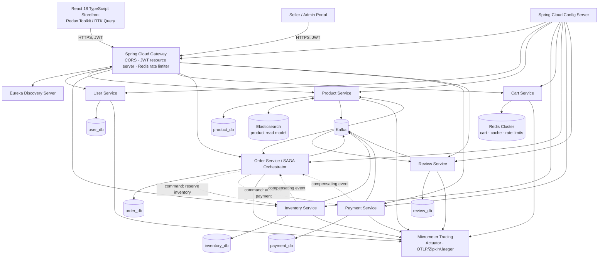

# Phase 1 — E-Commerce Platform Architecture

## System architecture



### Boundary and flow rules

- Each service owns its schema exclusively; service-to-service data access is through versioned REST contracts or Kafka events, never cross-schema joins.
- Order Service is the SAGA orchestrator. It persists `CREATED`, emits `InventoryReservationRequested`, then emits `PaymentAuthorizationRequested` only after a reservation. Failure events trigger `InventoryReleaseRequested` and an order cancellation.
- Every service writes an `outbox_event` in the same local transaction as its state transition. A publisher marks a row as published only after the Kafka acknowledgement.
- Product writes update MySQL and publish catalog events; an indexer maintains the Elasticsearch query projection. Redis is an expendable cache/read model, never the source of truth except carts.
- Gateway authenticates access tokens; downstream services still enforce scopes/roles, so direct internal calls cannot bypass authorization.

## Repository structure

The existing Gradle build remains the backend monorepo. The frontend is a sibling repository so it can be versioned and deployed independently.

```text
e-commerce-app/
├── build.gradle                     # shared Java 17 / Spring dependency conventions
├── settings.gradle                  # service modules
├── config-server/
├── discovery-server/
├── api-gateway/
├── user-service/
├── product-service/
├── inventory-service/
├── cart-service/
├── order-service/                   # SAGA orchestration owner
├── payment-service/
├── review-service/
├── shared-contracts/                 # versioned event/API DTOs only; no domain entities
├── database/
│   └── ddl/
│       ├── 01-user-db.sql
│       ├── 02-product-db.sql
│       ├── 03-inventory-db.sql
│       ├── 04-order-db.sql
│       ├── 05-payment-db.sql
│       └── 06-review-db.sql
├── docker/
│   ├── compose/
│   └── observability/
└── docs/
    └── architecture/

Each service module:
<service>/src/main/java/com/acme/commerce/<service>/{api,application,domain,infrastructure,config}/
<service>/src/main/resources/{application.yml,db/migration/}
<service>/src/test/java/.../{unit,integration}/

e-commerce-web/
├── src/
│   ├── app/                         # router, Redux store, providers
│   ├── features/{auth,catalog,cart,checkout,orders,admin}/
│   ├── components/{ui,layout,feedback}/
│   ├── lib/{api,validation,formatters}/
│   ├── hooks/
│   ├── types/
│   └── test/
├── public/
├── vite.config.ts
├── tailwind.config.ts
└── package.json
```

The SQL files are baseline schema specifications. In implementation, each is converted into versioned Flyway migrations kept by the owning service.
